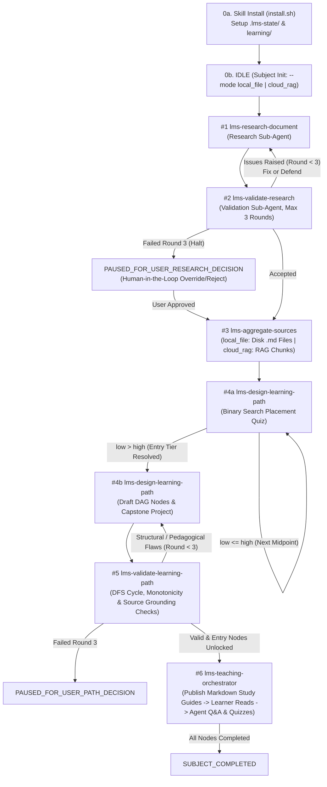
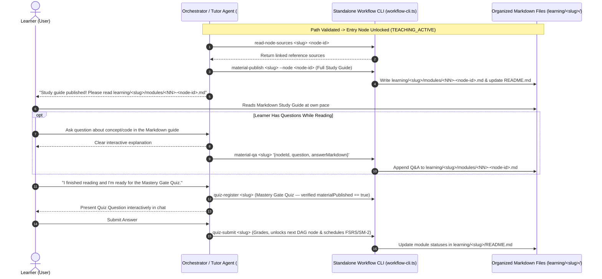

# Agentic Workflows — Adaptive LMS 6-Skill Agent Workflow

A standalone, deterministic **Multi-Agent Learning Management System (LMS) Workflow** built as 6 modular skills inside [`.agents/skills/`](./.agents/skills/). Designed to run local-first with zero external npm dependencies, full token telemetry, visual Mermaid artifacts, and an organized Markdown course book structure.

---

## 1. Core Philosophy & Learning Workflow

Every learner gets a dedicated AI Agent Orchestrator and specialized sub-agents tailored to their cognitive style, pace, and prior knowledge:

1. **Install & Initialize (`install.sh`)**:
   - Sets up a self-ignored `.lms-state/` directory (for state, token audit logs, and Mermaid/debate artifacts) and an organized user-facing `learning/<subject-slug>/` directory.
2. **Curate & Validate Knowledge (Skills `#1`, `#2`, `#3`)**:
   - **Track 1 (Bring Your Own Sources — BYOS)**: Ingests user-supplied documents (`.pdf`, `.docx`, `.xlsx`, `.md`) into normalized Markdown reference files.
   - **Track 2 (Multi-Perspective Web Research & 3-Round Peer-Review Loop)**: The **Research Sub-Agent** (`lms-research-document`) synthesizes multi-perspective findings (`theory`, `practical`, `critique`) with primary citations. The **Validation Sub-Agent** (`lms-validate-research`) critically peer-reviews the draft. The research agent can fix defects or defend claims with counter-evidence for up to **3 rounds**; if unresolved after Round 3, the workflow deterministically halts (`PAUSED_FOR_USER_RESEARCH_DECISION`) and escalates to the user.
3. **Pinpoint Entry Level via $\mathcal{O}(\log N)$ Binary Search Placement (Skill `#4a`)**:
   - Administers an interactive **Binary Search Diagnostic Placement Quiz** across ordered difficulty tiers $1 \dots N$, finding the learner's exact knowledge boundary (`entryDifficultyLevel`) in $\lceil \log_2 N \rceil$ questions and automatically marking prior tiers as `mastered_by_placement`.
4. **Draft & Deterministically Validate the DAG Learning Path + Capstone Project (Skills `#4b` & `#5`)**:
   - Designs a Directed Acyclic Graph (DAG) of atomic learning modules woven around a meaningful **Capstone Project**, then deterministically validates DAG acyclicity (3-color DFS), monotonic difficulty progression, source grounding, and milestone coverage (`lms-validate-learning-path`).
5. **Read from Organized Markdown Study Guides; Answer Q&A & Quizzes Through the Agent (Skill `#6`)**:
   - **No CLI Lectures**: The agent **never** dumps long lectures into the CLI/chat. Instead, for each unlocked module, the agent authors and publishes a comprehensive Markdown study guide into `learning/<subject-slug>/modules/<NN>-<node-id>.md` (`material-publish`) and updates the Master Course Index (`learning/<subject-slug>/README.md`).
   - **Self-Paced Reading**: The learner reads the organized Markdown file directly at their own pace.
   - **Interactive Q&A via Agent (`material-qa`)**: Any question the learner asks is answered conversationally by the agent **and** automatically appended to the bottom of that module's Markdown file (`## Learner Q&A & Clarifications`).
   - **Mastery Gate & Spaced Repetition Quizzes via Agent (`quiz-register`, `quiz-submit`)**: Quizzes (`mcq_4` with 4 options, `open_ended`, `code_challenge`, `project_task`) are administered and graded interactively through the agent. Note: the engine deterministically blocks registering a Mastery Gate quiz until the module's Markdown study guide has been published (`material-publish`). Passing unlocks the next DAG module and schedules **FSRS / SM-2 Spaced Repetition** reviews.

---

## 2. End-to-End Architecture & State Machine

### 2.1 Deterministic Workflow State Machine



### 2.2 Learner & Agent Interaction Sequence (Learning Phase)



---

## 3. The 6 Agent Skills (`.agents/skills/`)

All scripts are 100% standalone inside [`.agents/skills/`](./.agents/skills/) and require only Node.js built-ins:
- **Core Engine**: [`.agents/skills/lms-teaching-orchestrator/scripts/workflow.ts`](./.agents/skills/lms-teaching-orchestrator/scripts/workflow.ts)
- **CLI & Organizer**: [`.agents/skills/lms-teaching-orchestrator/scripts/workflow-cli.ts`](./.agents/skills/lms-teaching-orchestrator/scripts/workflow-cli.ts)
- **Environment Installer**: [`.agents/skills/lms-teaching-orchestrator/scripts/install.sh`](./.agents/skills/lms-teaching-orchestrator/scripts/install.sh)
- **Automated Test Suite**: [`.agents/skills/lms-teaching-orchestrator/scripts/workflow.test.ts`](./.agents/skills/lms-teaching-orchestrator/scripts/workflow.test.ts)

| # | Skill Name & Definition | Script Entrypoint | Deterministic CLI Subcommands | Key Guarantees |
| :- | :--- | :--- | :--- | :--- |
| **#1** | [`lms-research-document`](./.agents/skills/lms-research-document/SKILL.md) | [`scripts/run.ts`](./.agents/skills/lms-research-document/scripts/run.ts) | `research-submit` | Requires multi-perspective coverage (`theory`, `practical`, `critique`) & citations; supports `defenseArgument`; deterministically blocked if round > 3. |
| **#2** | [`lms-validate-research`](./.agents/skills/lms-validate-research/SKILL.md) | [`scripts/run.ts`](./.agents/skills/lms-validate-research/scripts/run.ts) | `research-validate`, `research-resolve` | Enforces 3-round peer-review limit; evaluates defenses; halts at `PAUSED_FOR_USER_RESEARCH_DECISION` after 3 failed rounds. |
| **#3** | [`lms-aggregate-sources`](./.agents/skills/lms-aggregate-sources/SKILL.md) | [`scripts/run.ts`](./.agents/skills/lms-aggregate-sources/scripts/run.ts) | `source-ingest`, `source-aggregate` | Normalizes Track 1 (BYOS `.pdf`/`.docx`/`.xlsx`/`.md`) and Track 2 (`validated` research) into organized local `.md` files (`local_file`) or RAG chunks (`cloud_rag`). |
| **#4** | [`lms-design-learning-path`](./.agents/skills/lms-design-learning-path/SKILL.md) | [`scripts/run.ts`](./.agents/skills/lms-design-learning-path/scripts/run.ts) | `placement-start`, `placement-step`, `path-design` | Runs $\mathcal{O}(\log N)$ binary search placement to resolve `entryDifficultyLevel`; drafts DAG nodes & Capstone Project; auto-marks prior tiers `mastered_by_placement`. |
| **#5** | [`lms-validate-learning-path`](./.agents/skills/lms-validate-learning-path/SKILL.md) | [`scripts/run.ts`](./.agents/skills/lms-validate-learning-path/scripts/run.ts) | `path-validate` | Runs 3-color DFS cycle detection, difficulty monotonicity checks, source grounding checks, and capstone milestone checks before unlocking entry nodes. |
| **#6** | [`lms-teaching-orchestrator`](./.agents/skills/lms-teaching-orchestrator/SKILL.md) | [`scripts/workflow-cli.ts`](./.agents/skills/lms-teaching-orchestrator/scripts/workflow-cli.ts) | `install`, `init`, `visualize`, `simulate`, `read-node-sources`, `material-publish`, `material-qa`, `material-organize`, `quiz-register`, `quiz-submit`, `log-tokens`, `token-report` | Organizes all user-facing learning materials into `learning/<slug>/` Markdown files for the learner to read directly; blocks Mastery Gate quizzes until node material is published; answers Q&A & quizzes interactively through the agent. |

---

## 4. Organized Directory Layout (`learning/` & `.lms-state/`)

Running the installation step (`bash .agents/skills/lms-teaching-orchestrator/scripts/install.sh`) and executing a subject workflow produces two cleanly separated trees:

```text
learning/<subject-slug>/                           # 1. USER-FACING ORGANIZED LEARNING WORKSPACE
├── README.md                                      # Master Course Index, Placement Summary & Module Progress Table
├── capstone/
│   └── PROJECT_BRIEF.md                           # Capstone Project Specification & Milestone Checklist
├── modules/
│   ├── 01-<node-id>.md                            # (⚡ Mastered by Placement) Concise reference & summary
│   ├── 02-<node-id>.md                            # (📖 Active Module) Full Markdown Study Guide + Learner Q&A Log
│   └── 03-<node-id>.md                            # (🔒 Locked) Curriculum preview
└── references/
    ├── user/<source-id>.md                        # Organized Track 1 (BYOS) reference documents
    └── research/<topic-id>.md                     # Organized Track 2 (Validated Research) reference documents

.lms-state/                                        # 2. INTERNAL STATE, LOGS & ARTIFACTS (Self-Ignored in Git)
├── .gitignore                                     # Self-ignores (*) so repo git status stays clean
├── config.json                                    # Skill suite version, installed timestamp & directory paths
├── state/
│   └── <subject-slug>.json                        # Canonical subject workflow state snapshot
├── logs/
│   ├── workflow-events.log                        # Chronological log of install + skill transition events
│   ├── <subject-slug>-token-usage.jsonl           # Structured JSONL token telemetry audit log per task/node
│   └── <subject-slug>-maintenance.md              # Aggregated Markdown token & workflow maintenance report
└── artifacts/
    └── <subject-slug>/
        ├── dashboard.txt                          # Latest ASCII workflow dashboard snapshot
        ├── workflow-graph.mmd                     # Mermaid state machine diagram with active stage highlighted
        ├── learning-path-dag.mmd                  # Mermaid learning path DAG diagram with node statuses & tokens
        ├── path-validation.json                   # Structural & pedagogical DAG validation report
        └── research/
            └── <topic-id>-debate.md               # 3-round peer-review debate transcript & current draft
```

---

## 5. Dual Execution Modes (`--mode local_file` vs `--mode cloud_rag`)

| Mode Flag | Storage & Retrieval Strategy | RAG Chunking (`state.ragChunks`) | How Node Knowledge is Read (`retrieveKnowledgeForNode`) |
| :--- | :--- | :--- | :--- |
| **Mode #1: `local_file`** *(Default)* | Local File-Based Knowledge System on Disk (`learning/<slug>/` & `.lms-state/knowledge/`) | **Disabled (`[]`)**: No RAG or vector indexing is needed. | Reads Markdown files directly from disk via `localFilePath`. |
| **Mode #2: `cloud_rag`** | Cloud System (MCP Server + GitHub Repo + `pgvector`) | **Enabled**: Sources are deterministically split by Markdown headings (`#`, `##`, `###`) into `RagChunk` records. | Queries `state.ragChunks` filtered by the node's linked `sourceIds`. |

---

## 6. Quickstart & Verification Commands

```bash
# 1. Run the skill installation step (initializes .lms-state/ logs/artifacts and learning/ folder)
bash .agents/skills/lms-teaching-orchestrator/scripts/install.sh

# 2. Run the deterministic end-to-end simulation of all 6 skills (Mode #1: local_file default)
node .agents/skills/lms-teaching-orchestrator/scripts/workflow-cli.mjs simulate --mode local_file

# 3. Inspect the generated Token Usage & Workflow Maintenance Report
node .agents/skills/lms-teaching-orchestrator/scripts/workflow-cli.mjs token-report raft-consensus-go

# 4. Run the standalone unit & integration test suite
node --test .agents/skills/lms-teaching-orchestrator/scripts/workflow.test.mjs
```
